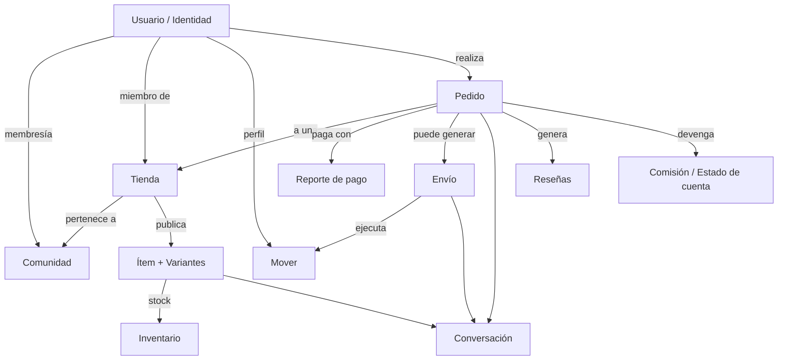
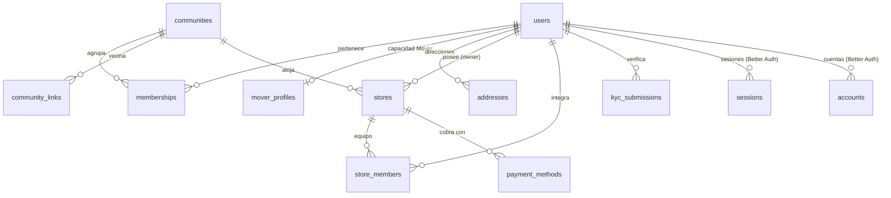
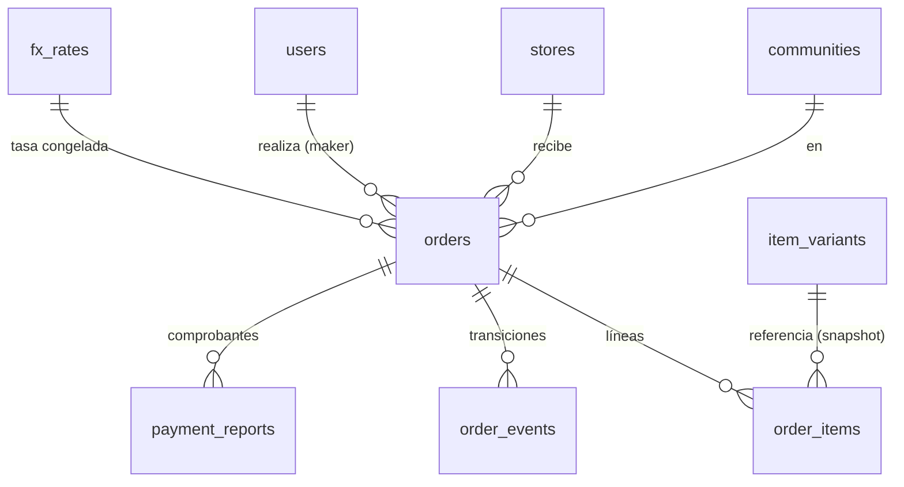
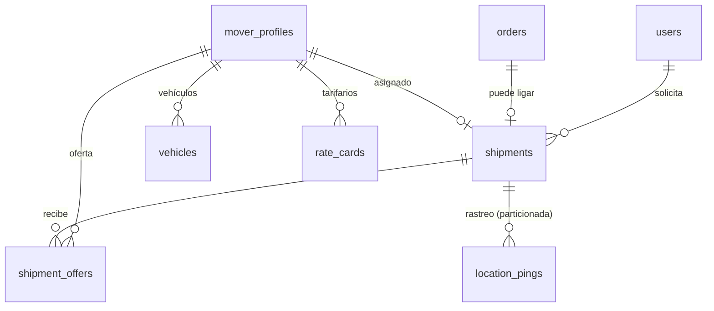
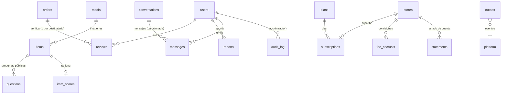
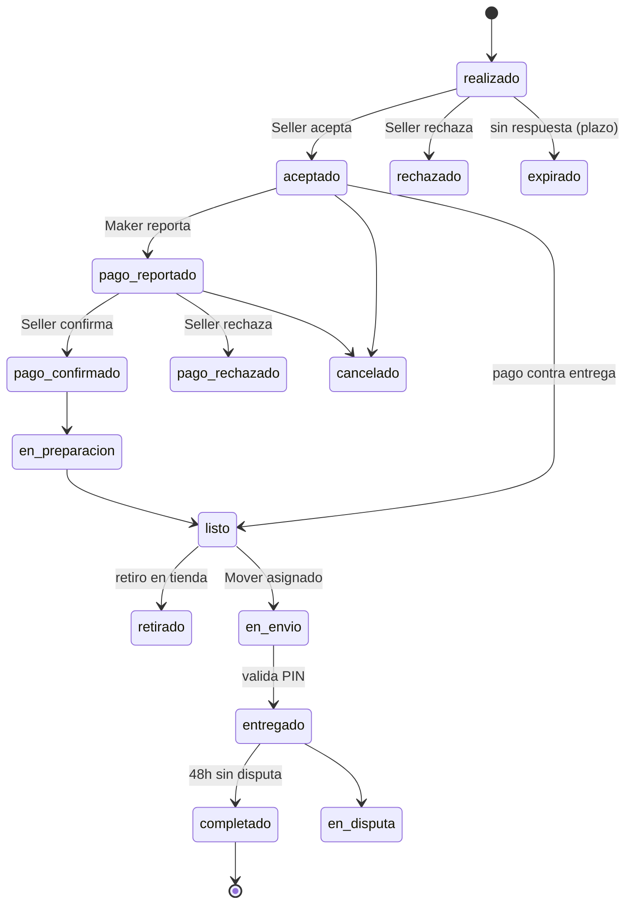
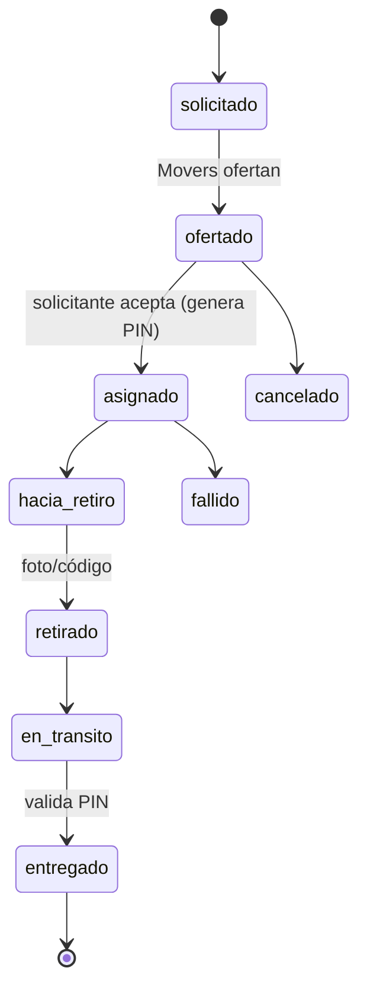

# 3B — Modelo de datos y objetos (MVP)

> **Estado: APROBADO** (ADR-002 Aceptada); abierto a revisión del equipo. Las
> migraciones de M2 pueden comenzar siguiendo §7. Fuente funcional: **Playbook v1.0**.
> Reconcilia lo **ya implementado** (identity/community/store + auth + RLS) con el
> modelo objetivo del MVP (Playbook Fase 1).

Relacionado: **ADR-001** (arquitectura fundacional) y **ADR-002** (decisiones de
este modelo de datos), en `docs/architecture/adr/`.

## 0. Convenciones transversales

- **Identificadores**: `uuid` v7 (ordenables por tiempo) cuando corresponda; hoy el
  default es `gen_random_uuid()` (v4). Ver decisión **D-07**.
- **Fechas**: `timestamptz`. `created_at`/`updated_at` en toda tabla mutable.
- **Dinero**: `numeric(12,2)` + **moneda explícita** (`currency` enum `USD`|`VES`),
  nunca float. Cada pedido congela `fx_rate_ves` (tasa BCV del día).
- **Geo**: PostGIS `geography(Point,4326)` para puntos; `geography(Polygon,4326)`
  para límites/zonas. Ver decisión **D-06** (hoy diferido en el esquema real).
- **Un esquema Postgres por módulo**; nadie escribe en tablas ajenas (solo vía el
  `index.ts` del módulo dueño o reaccionando a un evento del outbox).
- **RLS** en toda tabla con datos de usuario/tienda/comunidad; el runtime usa el rol
  `app` (sin BYPASSRLS); contexto por transacción (`SET LOCAL app.user_id`).
- **Enums**: se modelan como `text` + `CHECK`/validación Zod (portabilidad y
  evolución simples) salvo que se justifique un `pg enum`. Fuente de verdad: `@3b/contracts`.
- **Ledger de solo inserción** para dinero/stock (movimientos inmutables + proyección).

## 1. Modelo conceptual

La AI de 3B gira en torno a **seis objetos** (Playbook §04): **Comunidad, Tienda,
Ítem, Pedido, Envío, Conversación** — más la **Identidad** (usuario) transversal.

**Dominios del MVP** (un módulo por dominio): `identity`, `community`, `store`,
`catalog`, `inventory`, `orders`, `payments`, `shipping`, `tracking`, `messaging`,
`social`, `billing`, `ranking`, `notifications`, `media`, `platform`.

## 2. Diagramas entidad-relación por dominio

### 2.1 Identidad + Comunidad + Tienda (implementado)

### 2.2 Catálogo + Inventario

```mermaid
erDiagram
  categories ||--o{ categories : "subcategoría"
  categories ||--o{ items : "clasifica"
  stores ||--o{ items : "publica"
  templates ||--o{ items : "instancia"
  stores ||--o{ templates : "propias"
  attribute_definitions ||--o{ templates : "compone"
  items ||--o{ item_variants : "variantes"
  items ||--o{ item_attr_index : "proyección de filtros"
  items ||--o| service_details : "si es servicio"
  item_variants ||--o| stock_levels : "nivel de stock"
  item_variants ||--o{ stock_movements : "libro de movimientos"
  item_variants ||--o{ reservations : "reservas"
  orders ||--o{ reservations : "reserva para"
```

### 2.3 Pedidos + Pagos

### 2.4 Envíos + Tracking

### 2.5 Social + Messaging + Billing + Ranking + Media + Platform

## 3. Diccionario de entidades

Formato: **tabla** · PK · columnas clave · FKs · unicidad · índices · **módulo** · hito.
(“✅ hecho” = ya migrado; `M#` = migración propuesta para ese hito.)

### `identity` — propietario: módulo **identity**

| Tabla                                 | PK        | Columnas clave                                                                                                      | FK                                                               | Unicidad / índices                        | Estado                                  |
| ------------------------------------- | --------- | ------------------------------------------------------------------------------------------------------------------- | ---------------------------------------------------------------- | ----------------------------------------- | --------------------------------------- |
| `users`                               | `id`      | email, email_verified, name, image, phone, **default_community_id**, **is_platform_admin**, status, avatar_media_id | default_community_id→communities (blanda), avatar_media_id→media | `unique(email)`                           | ✅                                      |
| `sessions` `accounts` `verifications` | `id`      | (Better Auth) token/expires, provider/password, identifier/value                                                    | user_id→users                                                    | `unique(sessions.token)`                  | ✅                                      |
| `addresses`                           | `id`      | label, **location** `geography(Point)`, reference_text, facade_media_id                                             | user_id→users, community_id→communities                          | idx(user_id), idx GIST(location)          | M2                                      |
| `kyc_submissions`                     | `id`      | **subject_type** (store\|mover), **subject_id**, doc_type, status, reviewer_id, expires_at, media_id                | reviewer_id→users, media_id→media                                | idx(subject_type,subject_id), idx(status) | M2                                      |
| `mover_profiles`                      | `user_id` | status, operating_communities, rating, is_online, current_vehicle_id                                                | user_id→users                                                    | idx(is_online)                            | ✅ (ver **D-01**: ¿mover a `shipping`?) |
| `api_clients`                         | `id`      | name, scopes, created_by, last_used_at, revoked_at                                                                  | store_id→stores                                                  | —                                         | Fase 2 (MCP)                            |

### `community` — propietario: módulo **community**

| Tabla             | PK                          | Columnas clave                                                                                                                                           | FK                                      | Unicidad / índices                        | Estado                       |
| ----------------- | --------------------------- | -------------------------------------------------------------------------------------------------------------------------------------------------------- | --------------------------------------- | ----------------------------------------- | ---------------------------- |
| `communities`     | `id`                        | slug, name, type (town\|gated\|district), visibility (public\|private), **center** `geography(Point)`, **boundary** `geography(Polygon)`, settings jsonb | —                                       | `unique(slug)`, idx GIST(center/boundary) | ✅ (geo pendiente, **D-06**) |
| `community_links` | (community_id, neighbor_id) | distance_km, weight                                                                                                                                      | ambos→communities                       | idx(community_id)                         | ✅                           |
| `memberships`     | (user_id, community_id)     | role (member\|moderator\|admin), status                                                                                                                  | user_id→users, community_id→communities | idx(community_id)                         | ✅                           |

### `store` — propietario: módulo **store**

| Tabla             | PK                  | Columnas clave                                                                                                                                                 | FK                                       | Unicidad / índices                                             | Estado                        |
| ----------------- | ------------------- | -------------------------------------------------------------------------------------------------------------------------------------------------------------- | ---------------------------------------- | -------------------------------------------------------------- | ----------------------------- |
| `stores`          | `id`                | kind (products\|services), slug, name, status, **location**, **service_area** `geography(Polygon)`, verification_level, rating_avg, rating_count, health_score | community_id→communities, owner_id→users | `unique(community_id, slug)`, idx(community_id), idx(owner_id) | ✅ base (faltan columnas: M2) |
| `store_members`   | (store_id, user_id) | role (owner\|admin\|catalog\|sales)                                                                                                                            | store_id→stores, user_id→users           | idx(user_id)                                                   | ✅                            |
| `payment_methods` | `id`                | type (pago_movil\|transferencia\|zelle\|binance\|efectivo\|otro), **details (cifrado)**, active                                                                | store_id→stores                          | idx(store_id)                                                  | M2                            |

### `catalog` — propietario: módulo **catalog** (M2)

| Tabla                   | PK                      | Columnas clave                                                                                                                                                                                               | FK                                                                                       | Unicidad / índices                                                                      | Estado                        |
| ----------------------- | ----------------------- | ------------------------------------------------------------------------------------------------------------------------------------------------------------------------------------------------------------ | ---------------------------------------------------------------------------------------- | --------------------------------------------------------------------------------------- | ----------------------------- |
| `categories`            | `id`                    | parent_id, **path (ltree)**, name, slug, kind (product\|service\|both)                                                                                                                                       | parent_id→categories                                                                     | `unique(slug)`, idx GIST(path)                                                          | M2                            |
| `attribute_definitions` | `id`                    | **scope** (global\|category\|store), **scope_id**, key, label, data_type, options jsonb, unit, rules jsonb, filterable, variant_axis                                                                         | scope_id (polimórfico, **D-02**)                                                         | idx(scope,scope_id)                                                                     | M2                            |
| `templates`             | `id`                    | store_id (null=plataforma), name, attribute_ids (ordenados)                                                                                                                                                  | store_id→stores                                                                          | idx(store_id)                                                                           | M2                            |
| `items`                 | `id`                    | kind, title, slug, description, price_amount `numeric(12,2)`, currency, price_mode (fixed\|from\|quote), attributes jsonb, status, **search_tsv tsvector**, published_at, **community_id** (denorm **D-05**) | store_id→stores, community_id→communities, category_id→categories, template_id→templates | `unique(store_id, slug)`, idx(community_id,status), GIN(search_tsv), GIN trigram(title) | M2 (tsv/índices búsqueda: M4) |
| `item_variants`         | `id`                    | sku, barcode, axis_values jsonb, price_amount (opt), track_stock                                                                                                                                             | item_id→items                                                                            | `unique(item_id, sku)`, idx(barcode)                                                    | M2                            |
| `item_attr_index`       | (item_id, attribute_id) | num_value, text_value                                                                                                                                                                                        | item_id→items, attribute_id→attribute_definitions                                        | idx(attribute_id,num_value), idx(attribute_id,text_value)                               | M2                            |
| `service_details`       | `item_id`               | duration_min, modality (domicilio\|local\|remoto), coverage_km                                                                                                                                               | item_id→items                                                                            | —                                                                                       | M2                            |

### `inventory` — propietario: módulo **inventory** (M3)

| Tabla             | PK           | Columnas clave                                                                                                                                           | FK                                        | Unicidad / índices                                                          | Estado |
| ----------------- | ------------ | -------------------------------------------------------------------------------------------------------------------------------------------------------- | ----------------------------------------- | --------------------------------------------------------------------------- | ------ |
| `stock_levels`    | `variant_id` | on_hand, reserved, low_threshold, **version**                                                                                                            | variant_id→item_variants                  | idx(on_hand-reserved) parcial                                               | M3     |
| `stock_movements` | `id`         | type (in\|out\|adjust\|reserve\|release), channel (online\|local\|mcp\|import\|adjust), qty, ref_type, ref_id, actor_type, actor_id, **idempotency_key** | variant_id→item_variants                  | `unique(idempotency_key)`, idx(variant_id, created_at) · **solo inserción** | M3     |
| `reservations`    | `id`         | qty, status (active\|consumed\|released), expires_at                                                                                                     | variant_id→item_variants, order_id→orders | idx(expires_at where active), idx(order_id)                                 | M3     |

### `orders` — propietario: módulo **orders** (M5)

| Tabla          | PK   | Columnas clave                                                                                                                                        | FK                                                        | Unicidad / índices                                    | Estado |
| -------------- | ---- | ----------------------------------------------------------------------------------------------------------------------------------------------------- | --------------------------------------------------------- | ----------------------------------------------------- | ------ |
| `orders`       | `id` | **number**, status, fulfillment (pickup\|delivery\|service), subtotal, shipping_amount, fee_amount, currency, **fx_rate_ves**, address_snapshot jsonb | community_id→communities, store_id→stores, maker_id→users | `unique(number)`, idx(store_id,status), idx(maker_id) | M5     |
| `order_items`  | `id` | title/price **congelados**, qty, variant_id                                                                                                           | order_id→orders, variant_id→item_variants                 | idx(order_id)                                         | M5     |
| `order_events` | `id` | from, to, actor_id, reason, created_at                                                                                                                | order_id→orders                                           | idx(order_id, created_at) · **solo inserción**        | M5     |

### `payments` — propietario: módulo **payments** (M5)

| Tabla             | PK     | Columnas clave                                                               | FK                                                                        | Unicidad / índices                         | Estado |
| ----------------- | ------ | ---------------------------------------------------------------------------- | ------------------------------------------------------------------------- | ------------------------------------------ | ------ |
| `payment_reports` | `id`   | method, amount, currency, **reference**, proof_media_id, status, reviewed_by | order_id→orders (o invoice_id→statements, **D-03**), proof_media_id→media | `unique(method, reference)`, idx(order_id) | M5     |
| `fx_rates`        | `date` | source (BCV), usd_ves                                                        | —                                                                         | pk(date)                                   | M5     |

### `shipping` + `tracking` — propietarios: módulos **shipping** / **tracking** (M6)

| Tabla             | PK                         | Columnas clave                                                                                                                | FK                                                                 | Unicidad / índices                                  | Estado |
| ----------------- | -------------------------- | ----------------------------------------------------------------------------------------------------------------------------- | ------------------------------------------------------------------ | --------------------------------------------------- | ------ |
| `vehicles`        | `id`                       | type (moto\|carro\|camioneta\|bici), plate, model, color, capacity_kg, status                                                 | mover_id→mover_profiles                                            | idx(mover_id)                                       | M6     |
| `rate_cards`      | (mover_id, vehicle_type)   | base_fee, per_km, min_fee                                                                                                     | mover_id→mover_profiles                                            | —                                                   | M6     |
| `shipments`       | `id`                       | status, origin/destination `geography(Point)`, origin_ref/dest_ref, package jsonb, agreed_price, **pin_hash**, proof_media_id | order_id→orders (opt), requester_id→users, mover_id→mover_profiles | idx(status), idx(mover_id), GIST(origin)            | M6     |
| `shipment_offers` | `id`                       | price, eta_min, status, expires_at                                                                                            | shipment_id→shipments, mover_id→mover_profiles                     | idx(shipment_id), idx(expires_at where active)      | M6     |
| `location_pings`  | (shipment_id, recorded_at) | point `geography(Point)`, speed, heading                                                                                      | shipment_id→shipments                                              | **particionada por mes**, retención 90 d (**D-08**) | M6     |

### `messaging` / `social` / `billing` / `ranking` / `media` / `platform`

| Tabla           | PK        | Columnas clave                                                              | FK                                             | Unicidad / índices                                | Módulo · Hito           |
| --------------- | --------- | --------------------------------------------------------------------------- | ---------------------------------------------- | ------------------------------------------------- | ----------------------- |
| `conversations` | `id`      | context (item\|order\|shipment\|store), context_id, participants            | —                                              | idx(context,context_id)                           | messaging · M5          |
| `messages`      | `id`      | body, media_id, read_at                                                     | conversation_id→conversations, sender_id→users | **particionada por mes**                          | messaging · M5          |
| `reviews`       | `id`      | **subject_type** (store\|mover\|maker), subject_id, rating, body            | order_id→orders, author_id→users               | `unique(order_id, author_id, subject_type)`       | social · M5 (**D-04**)  |
| `questions`     | `id`      | body, answer, answered_at                                                   | item_id→items, author_id→users                 | idx(item_id)                                      | social · M5             |
| `reports`       | `id`      | target_type, target_id, reason, status                                      | reporter_id→users                              | idx(status)                                       | social · M5             |
| `plans`         | `id`      | code (seller_products\|seller_services), price_amount, currency             | —                                              | `unique(code)`                                    | billing · M7            |
| `subscriptions` | `id`      | status (trial\|active\|past_due\|cancelled), period_end                     | store_id→stores, plan_id→plans                 | idx(store_id), idx(status)                        | billing · M7            |
| `fee_accruals`  | `id`      | kind (sale\|shipment), amount, currency, accrued_at                         | store_id→stores, order_id/shipment_id          | idx(store_id, accrued_at) · **solo inserción**    | billing · M7            |
| `statements`    | `id`      | period, total, currency, status                                             | store_id→stores                                | `unique(store_id, period)`                        | billing · M7            |
| `item_scores`   | `item_id` | quality, conversion, freshness, availability, novelty, penalty, computed_at | item_id→items                                  | idx(community score)                              | ranking · M4            |
| `media`         | `id`      | bucket, key, mime, sizes jsonb, **owner_type**, owner_id, created_by        | created_by→users                               | idx(owner_type,owner_id)                          | **media · M2 (núcleo)** |
| `outbox`        | `id`      | topic, payload jsonb, published_at                                          | —                                              | idx(published_at where null) · **solo inserción** | platform · M3           |
| `audit_log`     | `id`      | action, subject_type, subject_id, metadata jsonb                            | actor_id→users                                 | idx(created_at) · **solo inserción**              | platform · ✅           |

## 4. Autorización, membresías y aislamiento multi-comunidad

Modelo ya implementado (Hito B) y **obligatorio para toda tabla nueva**:

- **Identidad global, contenido local**: un usuario existe una vez; `users`.
  Capacidades (no roles globales): **Maker** (todos), **Seller** (≥1
  `store_members` activo), **Mover** (`mover_profiles` aprobado), **admin de
  comunidad** (`memberships.role='admin'`), **admin de plataforma**
  (`users.is_platform_admin`).
- **Alcance**: cada fila de negocio lleva `community_id` (directo o derivable). La
  comunidad activa va en la sesión/URL; **nunca** se confía en el `community_id`
  del cliente como prueba de autorización.
- **RLS de mínimo privilegio**: rol `app` sin BYPASSRLS; contexto por transacción
  (`SET LOCAL app.user_id`); funciones `authz.*` (`SECURITY DEFINER`) derivan
  permisos de la base: `current_user_id`, `is_platform_admin`, `is_member`,
  `is_community_admin`, `is_store_member`, `shares_community`, `can_see_community`.
- **Patrón por tabla nueva** (regla obligatoria): (a) `ENABLE ROW LEVEL SECURITY`;
  (b) grants mínimos a `app`; (c) políticas SELECT (visibilidad por comunidad/tienda)
  y write (owner/admin con alcance); (d) para tiendas, reutilizar
  `authz.is_store_member(store_id, roles)`; (e) para comunidades,
  `authz.can_see_community(community_id)`.
- **Impersonación ("Ver como")**: solo platform admin; cambia el `app.user_id`
  efectivo con banner + auditoría (M1).
- **Auditoría**: toda acción administrativa sensible → `platform.audit_log`.

## 5. Invariantes transaccionales

### Inventario (M3)

- **I-1 Disponible** = `on_hand - reserved`. Único número visible para Makers,
  carritos y búsqueda.
- **I-2 Sin sobreventa (online)**: descuento atómico condicionado —
  `UPDATE stock_levels SET on_hand = on_hand - :q, version = version + 1
  WHERE variant_id = :v AND on_hand - reserved >= :q RETURNING ...`; si no
  devuelve fila → rechazo inmediato (sin locks largos).
- **I-3 Ledger inmutable**: `stock_movements` es solo inserción; `stock_levels` es
  su proyección, actualizada **en la misma transacción**.
- **I-4 Idempotencia**: cada movimiento lleva `idempotency_key` único → un reintento
  nunca descuenta dos veces.
- **I-5 Reservas con vencimiento**: al aceptar un pedido se reserva con `expires_at`
  (p. ej. 30 min); el worker libera vencidas y emite `stock.changed`.
- **I-6 Venta local offline**: puede dejar stock negativo (la venta física ya
  ocurrió); se marca `oversold` y alerta al Seller.

### Pedidos (M5)

- **O-1** Precios/títulos **congelados** en `order_items` al crear la línea.
- **O-2** Transición válida solo según la máquina de estados (§6); cada cambio deja
  fila en `order_events` (inmutable) con actor y motivo.
- **O-3** Al `aceptado` se **reserva** stock; al `cancelado` (antes de `en_envío`)
  se **libera**; al `completado` se devenga comisión y se habilitan reseñas.
- **O-4** Creación de pedido exige `Idempotency-Key`.

### Pagos (M5)

- **P-1** `unique(method, reference)` en `payment_reports` → bloquea referencias
  bancarias duplicadas.
- **P-2** `fx_rate_ves` se **congela** en el pedido al crearlo (el monto en Bs no
  cambia después).
- **P-3** Confirmación/rechazo de pago es acción del Seller; cambia el estado del
  pedido vía la máquina de estados.

### Envíos (M6)

- **S-1** Ofertas vencen a los 10 min; sin ofertas se amplía el radio.
- **S-2** Al `asignado` se genera un `pin_hash`; las demás ofertas se rechazan.
- **S-3** Entrega validada con el **PIN** del receptor → cierra viaje y devenga
  comisión.
- **S-4** `fallido`/`cancelado` exige motivo y afecta métricas de cumplimiento.

> Todas las invariantes de dinero/stock operan sobre **ledgers de solo inserción**
> con proyección en la misma transacción, y se publican vía **outbox** (entrega
> garantizada, sin perder eventos).

## 6. Máquinas de estados y dependencias

### Pedido (productos)

### Pedido (servicios)

`solicitud → cotizado → aceptado → pago → en_curso → completado` (si el precio es
fijo, se salta `cotizado`).

### Envío

### Dependencias entre objetos (orden de construcción)

`identity/community` → `store` → `catalog` → `inventory` → `orders` →
`payments` → `shipping/tracking` → `social/messaging` → `billing` → `ranking`.
`media` y `notifications` son transversales (media entra en M2).

## 7. Propuesta de migraciones incrementales

**No** se crean todas las tablas de entrada. Cada hito agrega migración(es)
aditiva(s) (nunca editar una aplicada). Estado actual aplicado: `0000`–`0004`
(identity + auth, community, store base, platform.audit_log, RLS/authz).

| Hito    | Migración(es) propuestas                                            | Contenido                                                                                                                                                                                        |
| ------- | ------------------------------------------------------------------- | ------------------------------------------------------------------------------------------------------------------------------------------------------------------------------------------------ |
| (infra) | `uuidv7()` SQL + switch de defaults                                 | Si se aprueba **D-07**                                                                                                                                                                           |
| **M2**  | `catalog_*`, `store_extend`, `identity_addresses_kyc`, `media_core` | categorías/atributos/plantillas/ítems/variantes/attr_index/service_details; columnas de `stores` + `payment_methods`; `addresses` + `kyc_submissions`; **núcleo de `media`** + RLS de cada tabla |
| **M3**  | `inventory_*`, `platform_outbox`                                    | stock_levels/movements/reservations + `outbox` + RLS                                                                                                                                             |
| **M4**  | `catalog_search`, `ranking_scores`                                  | `search_tsv` + índices GIN/trigram; `item_scores`                                                                                                                                                |
| **M5**  | `orders_*`, `payments_*`, `messaging_*`, `social_*`                 | ver §3; cada uno con RLS y su máquina de estados                                                                                                                                                 |
| **M6**  | `shipping_*`, `tracking_pings`                                      | vehicles/rate_cards/shipments/offers + pings particionados; enriquecer `mover_profiles`                                                                                                          |
| **M7**  | `billing_*`                                                         | plans/subscriptions/fee_accruals/statements                                                                                                                                                      |

Cada migración incluye: tablas + FKs + índices + `ENABLE RLS` + políticas + grants a
`app`. Las de alto volumen (`location_pings`, `messages`) se crean **particionadas**.

## 8. Inconsistencias, ambigüedades y decisiones pendientes

| #        | Tema                                             | Problema en el Playbook / realidad                                                           | Propuesta (ver ADR-002)                                                                                                                           |
| -------- | ------------------------------------------------ | -------------------------------------------------------------------------------------------- | ------------------------------------------------------------------------------------------------------------------------------------------------- |
| **D-01** | Dueño de `mover_profiles`                        | Playbook lo pone en `shipping`; lo implementamos en `identity`.                              | **Mover a `shipping`** (Mover = capacidad del dominio envíos); `identity` solo guarda la identidad base. Requiere migración de reubicación en M6. |
| **D-02** | `attribute_definitions.scope_id`                 | FK**polimórfica** (global→null, category→id, store→id).                                      | Columna `scope` + `scope_id` nullable, **sin FK dura**; integridad por trigger/aplicación. Índice `(scope, scope_id)`.                            |
| **D-03** | `payment_reports.order_id \| invoice_id`         | Referencia polimórfica (pedido **o** estado de cuenta).                                      | Dos columnas nullable (`order_id`, `statement_id`) + `CHECK` (exactamente una).                                                                   |
| **D-04** | `reviews` destinatario polimórfico               | "única por pedido y destinatario (Seller/Mover/Maker)".                                      | `subject_type` + `subject_id` + `unique(order_id, author_id, subject_type)`; sin FK dura al sujeto.                                               |
| **D-05** | `community_id` denormalizado en `items`/`orders` | Riesgo de inconsistencia con `store.community_id`.                                           | Denormalizar **sí** (rendimiento + RLS), con trigger que lo fija desde la tienda; una tienda vive en **una** comunidad.                           |
| **D-06** | Geo (PostGIS)                                    | El esquema real hoy **no** tiene columnas geográficas (se difirió).                          | Adoptar `geography(Point/Polygon,4326)`; `point` vía tipo custom de Drizzle, `polygon` vía SQL crudo. Entra con M4 (búsqueda) y M6 (envíos).      |
| **D-07** | UUID v7                                          | Playbook pide v7 (ordenable); hoy default `gen_random_uuid()` (v4).                          | Agregar `uuidv7()` (función SQL) y usarlo como default en tablas de alto volumen; v4 aceptable para el resto.                                     |
| **D-08** | Particionado (`location_pings`, `messages`)      | Drizzle no modela particiones declarativas.                                                  | Crear la tabla particionada por **SQL crudo** dentro de la migración; retención 90 d por job del worker.                                          |
| **D-09** | Nombres de esquema                               | Playbook mezcla `commerce.orders` y `payment.*` (singular) con módulos `orders`/`payments`.  | **Un esquema = nombre del módulo**: `orders`, `payments` (plural, consistente).                                                                   |
| **D-10** | Moneda por línea vs pedido                       | Ítems en USD/Bs; pedido con `currency` + `fx_rate_ves`.                                      | `currency` a nivel **pedido**; precios de línea en esa moneda; `fx_rate_ves` congela la conversión a Bs para mostrar.                             |
| **D-11** | `templates.attribute_ids` (array ordenado)       | Array de FKs no referenciable.                                                               | Tabla puente `template_attributes(template_id, attribute_id, position)` con FKs reales.                                                           |
| **D-12** | `changesets`/MCP, `api_clients`                  | Fase 2 (no MVP).                                                                             | **Fuera del MVP**; se modelan al activar el MCP del Seller.                                                                                       |

## 9. Propiedad de tablas (resumen) y reglas para trabajo paralelo

Cada tabla tiene **un único módulo propietario** (columna "Módulo" en §3). Reglas
**obligatorias** para que varios agentes/devs trabajen en paralelo sin colisiones:

1. **Propiedad exclusiva**: solo el módulo dueño define/migra sus tablas y escribe en
   ellas. Otros módulos leen vía su `index.ts` público o reaccionan a eventos
   (`outbox`), **nunca** por SQL directo a tablas ajenas (lo valida dependency-cruiser).
2. **Contratos primero**: todo DTO/enum/estado vive en `@3b/contracts` (Zod) antes de
   implementar; es la frontera tipada entre módulos y con la web.
3. **Migraciones aditivas**: nunca editar una aplicada; una migración nueva por cambio.
   Dos personas no tocan el mismo módulo a la vez.
4. **RLS no opcional**: ninguna tabla de negocio se expone sin política RLS + grants.
5. **`pnpm check` verde** (incluye límites de dependency-cruiser) antes de integrar.

> Este documento es la fuente de verdad del modelo hasta el MVP. Cambios => nueva
> entrada en el log de decisiones (ADR) + actualización de esta ficha.
